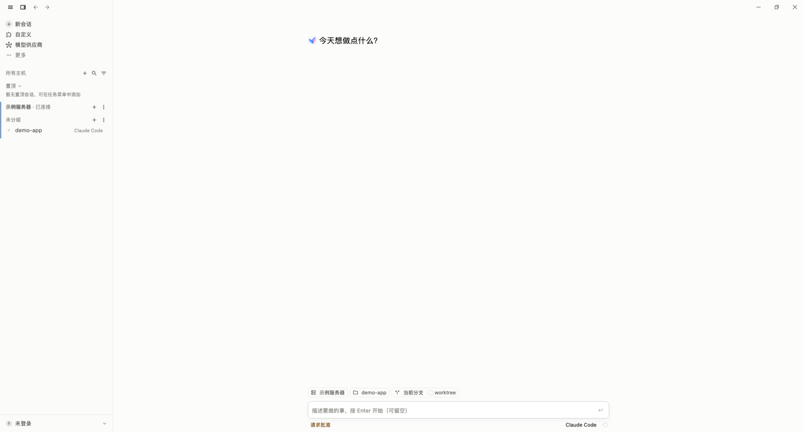
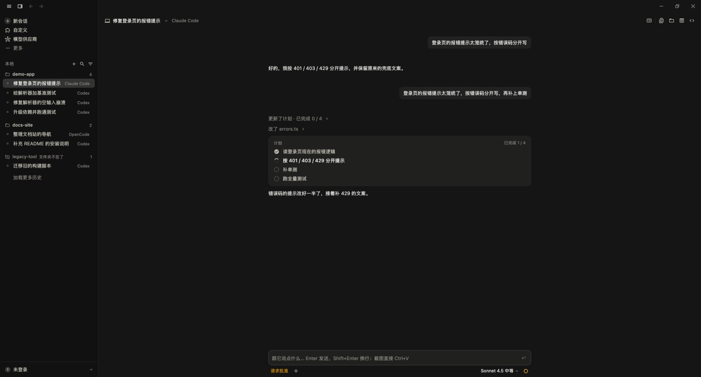

# Yunxi 云曦

**工作有进展，生活不必等。** 在电脑和手机上跟进你服务器（或本机）上的 AI Agent：Claude Code、Codex、OpenCode、Hermes、Gemini、Grok Build。

> 这里是 Yunxi 的公开主页：**下载、更新说明、反馈和插件列表**。Yunxi 的源代码不公开，不在这个仓库里。

## 下载

| 平台 | 系统要求 | 下载 |
| --- | --- | --- |
| Windows | Windows 10 及以上 | [Yxi-win-Setup.exe](https://yxi.keuury.com/desktop/Yxi-win-Setup.exe) |
| macOS（Apple 芯片） | macOS 12 及以上 | [Yxi-macos-arm64.dmg](https://yxi.keuury.com/desktop/Yxi-macos-arm64.dmg) |
| Android | Android 8.0 及以上 | [Yxi.apk](https://yxi.keuury.com/Yxi.apk) |

- 装好以后在 App 里检查更新，不用回来重新下载。
- Mac 第一次打开如果被拦下：到「系统设置 → 隐私与安全性」点「仍要打开」。
- iPhone 暂时没有公开安装包，开放后会写在这里。
- 官网：[yxi.keuury.com](https://yxi.keuury.com)

## 能做什么

- **桌面工作台**：按服务器和项目整理会话；对话、文件、终端、网页预览放在一个窗口里；需要你批准或拍板的事单独提醒。
- **本机和远程都能用**：Agent 跑在你自己的服务器上（通过 SSH 连接），也可以跑在这台电脑上。
- **手机随行**：离开座位也能看进度、回一句话、处理审批。
- **多个 Agent、多台机器**：一个工作台接你熟悉的运行器，供应商和线路可以按会话切换。

截图是测试环境里的演示数据。

## 更新说明

每一版改了什么见 [CHANGELOG.md](CHANGELOG.md)。

## 反馈

- 遇到问题、想要什么功能：[开一个 Issue](../../issues/new/choose)，按模板填就行。
- **别贴**密钥、令牌、服务器地址、私钥或对话里的私人内容；截图前遮一下。
- 安全问题请不要公开发：在 App 里「我的 → 工单」私下告诉我们。

## 插件

Yunxi 自带的和推荐的插件、合作伙伴见 [PLUGINS.md](PLUGINS.md)（机器可读的一份在 [plugins.json](plugins.json)）。想推荐你的插件，用 Issue 的「插件推荐」模板。

## 会员

会员不再收费：登录就是 Pro，永久有效。全部功能本来就都能免费用；档位只影响装扮（头像光环、徽章）和改昵称的次数。

## 隐私

- [隐私政策](https://yxi.keuury.com/privacy) · [服务条款](https://yxi.keuury.com/terms)
- 远程文件、终端和会话内容走你的电脑（或手机）和你的服务器之间的 SSH 连接。

觉得好用，欢迎点个 Star 支持一下。

---

### English

Yunxi is a desktop (Windows, macOS) and Android client for following AI coding agents (Claude Code, Codex, OpenCode, Hermes, Gemini, Grok Build) running on your own servers over SSH or on your computer. This repository is the public home for downloads, release notes, feedback and the plugin list; the source code is not public. Download links are in the table above. Please file bugs and feature requests as issues.

Yunxi is an independent third-party tool and is not affiliated with the vendors of the models or agents it supports. © 2026 Yunxi. Docs and images in this repository: all rights reserved.
